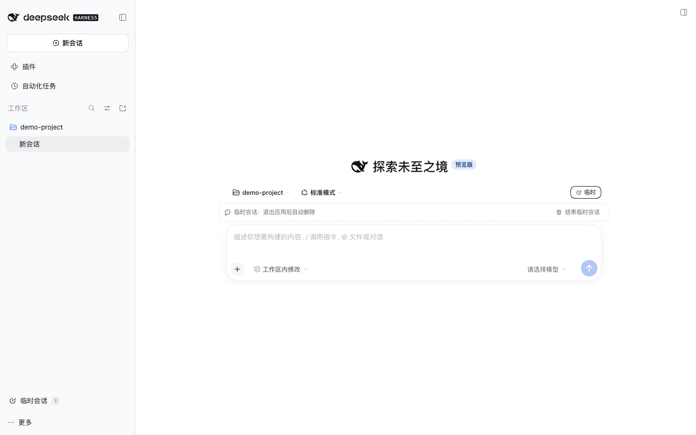

# 临时会话（Temporary Sessions）× DeepSeek Harness

[English](README.md)

一个无依赖的 DSH 插件，提供**临时会话**：从侧边栏新建一次性的对话，正常使用；退出应用时删除它的会话日志，重启后不会出现在历史列表中。

插件是标准 DSH 组合包（Host 插件 + Web Client 模块），纯 JavaScript、无构建步骤，可以直接从 GitHub 安装。



## 功能

- **侧边栏入口**：侧边栏底部「临时会话」按钮。
- **完整原生会话**：使用真实的 Agent、工具、模型、权限、流式输出与附件能力。
- **明确标识**：输入框上方有虚线临时条（空白会话也可见）并提供结束按钮；侧栏底部显示进行中的临时会话数量。发出第一条消息后，侧栏标题变为「临时会话 · HH:mm」，空闲时行首出现临时图标，标题栏显示「临时」标签。
- **无需打开即可结束**：输入框上方的「结束临时会话」，或会话行「…」菜单里的同名操作。结束后立刻归档并从列表隐藏。
- **退出即删除**：正常退出、`SIGTERM`、`SIGINT` 时同步删除所有临时会话的存储目录。
- **崩溃兜底**：进程被强制结束时，下次启动会在浏览器连上之前清掉上一轮残留。
- **中英双语**：跟随 DSH 的语言设置。

## 环境要求

- DeepSeek Harness `0.2.x`（声明了 `engines.dsh`；已用 `0.2.1-rc.1` Web profile 及其 Client bundle 验证，Desktop 使用相同的 Host 与 Client 扩展点）。
- 随产品交付的 JSONL 会话存储（`@deepseek-ai/dsh-session-persistence-jsonl`），Web/Desktop 默认即是。无法报告会话目录的后端会在注册时被明确拒绝。

## 安装

仓库本身就是可安装的组合包，没有构建步骤和 `prepare` 脚本。

### Desktop 应用

打开 **设置 → 插件**，添加入口并启用：

```text
github:wj-spec/dsh-temp-session-plugin
```

或用 CLI 装进 desktop profile：

```sh
dsh plugin --profile desktop add 'github:wj-spec/dsh-temp-session-plugin'
```

之后重启应用（或让 profile 热重载生效 Host 行），并刷新页面让浏览器加载 Client 模块。

### Web profile

```sh
dsh plugin --profile web add 'github:wj-spec/dsh-temp-session-plugin'
```

重启 Web 进程并刷新页面。

### 锁定版本

发布 tag 后固定到 tag，避免后续推送改变实际运行的代码：

```sh
dsh plugin --profile web add 'github:wj-spec/dsh-temp-session-plugin#v0.1.0'
```

### 卸载

```sh
dsh plugin --profile web remove dsh-temp-session-plugin
```

## 使用

1. 点击侧边栏底部的「临时会话」。会在当前项目目录（没有当前会话时取第一个 Workspace 的目录）打开一个全新空白会话。
2. 正常聊天。标题栏会显示「临时」标签。
3. 点标题栏垃圾桶，或在会话行「…」菜单里选「结束临时会话」，即可归档并隐藏。
4. 退出应用后，所有临时会话的日志目录都会被删除。

可以同时开多个临时会话；它们彼此独立，不会互相继承上下文。

## 工作原理

- **Host**（`index.js`、`core.js`）：记录临时会话 id 和 JSONL 存储返回的精确会话目录，设置标题，并负责删除。注册表位于 `$DSH_HOME/temp-session/records.json`（权限 `0600`）。
- **Web Client**（`client.js`）：注册带计数的侧栏入口、输入框上方标识与结束按钮、标题栏标签、行菜单项、行徽标。创建流程是普通的 `session.create`，随后调用自定义的 `tempSession/register` Remote。

删除时机：

| 时机 | 行为 |
|---|---|
| 退出应用 / `SIGTERM` / `SIGINT` | 同步删除所有已记录的临时会话目录。 |
| 插件卸载 / profile 热重载 | 只删除用户已「结束」的会话，仍在使用的保留。 |
| 下次启动 | 在浏览器连上之前，删除没有存活 Agent 的记录，并清理归档标记。 |

安全边界：

- 只有**全新的、空的、非 subagent、非 fork** 的会话才能注册为临时，不能把已有历史转成临时。
- 删除目标必须是绝对路径、至少三层深，且最后一段包含会话 id。
- 注册表位于 `$DSH_HOME` 下，原子写入。
- 插件不会碰附件，也不会碰其他会话的数据。

## 隐私说明

「临时」指**会话日志会被删除**，而不是完全不落盘：

- 会话期间 DSH 仍会写正常检查点日志，这是流式输出、工具与崩溃恢复的前提。
- **附件不会删除。** 图片等附件按内容哈希存放在 `$DSH_HOME/attachments/v1`，不按会话归属。需要完全干净时，不要在临时会话里附带敏感文件。
- **投影缓存不会单独清除。** `session_projcache` 里可能留有该会话 id 的一行；日志删除后这行不可达，也不会出现在列表或恢复中，但插件不会物理删除它。
- 被 `SIGKILL`（或断电）结束的进程，日志会一直留到同一 profile 下一次成功启动。

## 已知限制

- 结束临时会话只是归档 + 隐藏，日志要等应用退出才真正删除；DSH `0.2.x` 没有对存活 Agent 的逐会话删除接口。
- 远程/移动端没有 `tempSession` Remote 的授权，远程连接创建临时会话会被拒绝。
- 仅支持默认 JSONL 后端。
- UI 依赖 `0.2.x` 的稳定槽位（`sidebar.footer.action`、`conversation.session.header.actions`、`sidebar.workspaces.session.menu.item`、`sidebar.session.row.leading`、`shell.overlay`），未来 DSH 可能调整。

## 开发

请务必使用一次性 profile，不要在日常使用的 profile 上开发：

```sh
dsh --profile temp-dev --from-default-profile web --dump-config
dsh plugin --profile temp-dev add /绝对路径/dsh-temp-session-plugin
dsh --profile temp-dev --dump-config
dsh --profile temp-dev
```

测试不需要安装依赖：

```sh
npm test       # Host 清理规则 + Client 接线
npm run check  # 语法检查 + 测试
```

源码结构：

| 文件 | 职责 |
|---|---|
| `index.js` | Host 插件：服务、Remote 注册、启动/信号清理 |
| `core.js` | 注册表、路径安全、同步/异步删除（无 Cordis 依赖） |
| `remote.js` | Host 侧 Typert Remote 描述符 |
| `client.js` | 浏览器模块：入口、徽标、结束操作、提示 |
| `cordis.patch.yml` | 插入 Host 行的 Bundle 层 |
| `locale/*.json` | 插件管理器展示名称与描述 |

## 许可证

MIT，见 [LICENSE](LICENSE)。
